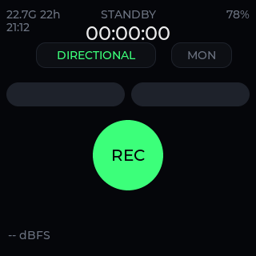
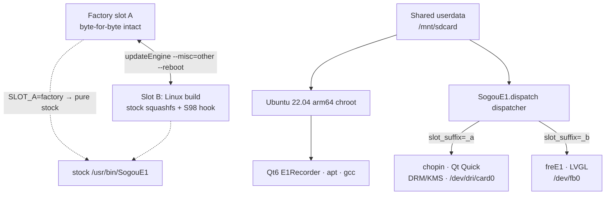
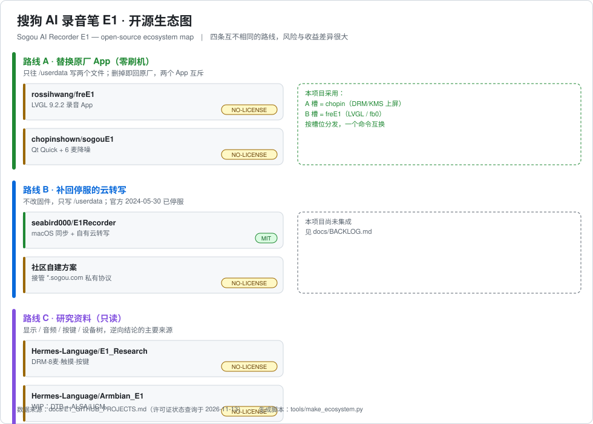

# Sogou E1 Open

**English** | [简体中文](README.md)

> An **unofficial** open-source rescue toolkit for the Sogou AI Recorder **E1**.
> Sogou's cloud service went dark on **2024-05-30**. This project keeps the device
> usable: export your recordings, drive the 8-microphone array, run a full arm64
> Linux next to the stock system, and boot two different open-source recorder apps
> from the two A/B slots.
> **The factory A slot is never written to and stays byte-for-byte intact**, so you
> can always fall back. No uboot / trust / GPT changes, and no factory firmware
> images in this repository.



*Real interface captured from the device's `/dev/fb0` framebuffer (320×320, LVGL 9.2.2)*

| | |
|---|---|
| Target device | Sogou AI Recorder E1 (RK3308 / Linux 4.4.143 / Buildroot 2018.02-rc3) |
| Verified on | **One** physical device, 2026-11-13. Other batches: check your own partition map and MD5s |
| Flashing | Most paths need **no flashing at all**; only the B-slot experiment writes `system_b` |
| Maintenance | Personal research notes, repackaged. No official support, no release guarantees |
| License | [MIT](LICENSE) for original content here; third-party components keep their own licenses |

---

## Before you start (read this)

> ⚠️ **Read [`docs/NOTICE.md`](docs/NOTICE.md) first.** It collects every caveat in one
> place: brick risk, warranty, recording-law compliance, privacy, licensing of
> upstream code, forbidden operations, and what has *not* been verified.

Three ground rules:

1. **Back up first.** Before touching a partition, `dd` your own copies of
   `boot_a/b`, `system_a/b` and `misc`. This repository ships no factory images.
2. **Never write the factory A slot.** It is the last line of defence; every
   experiment here writes only `system_b` and the shared `userdata` partition.
3. **Writes must be explicit.** `slot_tool.sh` is read-only by default; real
   operations require `--go`.

This project has **no affiliation with Sogou**. It contains no factory firmware,
partition images, recordings or databases. Flashing and disassembly can brick the
device — **you accept the risk**. All MD5s, PARTUUIDs and serials in the docs are
**example values from one device**; yours will differ.

---

## What it does

| Capability | How | Partitions touched |
|---|---|---|
| Export every recording after the shutdown | `scripts/export_recordings.py` reads `E1-DATA.db` + `adb pull` | ❌ read-only |
| Record straight from the 8-mic array | Stock named PCM `8c48kmic` (8 ch / 48 kHz / S32_LE) | ❌ read-only |
| Run a complete arm64 Linux | Stock kernel + **Ubuntu 22.04.5 chroot** (no flashing) | ❌ `userdata` only |
| Compile C/C++/Qt on the device | Native gcc / cmake / apt inside the chroot | ❌ |
| A reversible A/B dual system | Repack the `system_b` squashfs with one boot hook | ⚠️ `system_b` only |
| Two recorder apps, one per slot | A **slot-aware dispatcher** on the shared `userdata` | ❌ `userdata` only |

The last two have been run on real hardware: **slot A = chopin (Qt Quick, DRM/KMS
display path)**, **slot B = freE1 (LVGL, `/dev/fb0`)**. One
`updateEngine --misc=other --reboot` swaps them in ~20 seconds, and the MD5s of
all four partitions stayed unchanged throughout.

---

## Prerequisites

- **Your own E1**, with adb enabled: *Settings → About → tap "MAC Address"
  repeatedly → developer mode → Settings → turn adb on*.
- **PC side**: Android Platform-Tools (`adb` in `PATH`, or point `ADB` at
  `adb.exe`), Python 3, `curl`, Git Bash / `sh`. Windows helpers live in `windows/`.
- **Prefer USB.** The Wi-Fi adb link drops out when the device sleeps, which can
  make a slot switch *look* like it ran when it never did.
- Check the device first: `adb devices -l`, then
  `export E1_SERIAL=<your adb serial>` (scripts auto-pick the first device if unset).
- In Git Bash set `MSYS_NO_PATHCONV=1`, otherwise `/mnt/sdcard/...` gets rewritten
  into a Windows path. `. scripts/e1_env.sh` does all of this for you.

Full checklist: [`docs/INSTALL.md`](docs/INSTALL.md) §1.

---

## Install

Four levels, ordered by risk. **Do them in order, verify each one, and stop when
you have what you need.** L0 is enough if all you want is your recordings back.

| Level | What | Scope | Reboot | Reversible |
|---|---|---|---|---|
| L0 | Export recordings / record from the 8-mic array | read-only | no | inherently |
| L1 | Ubuntu 22.04 arm64 chroot | `/mnt/sdcard` | no | delete the folder |
| L2 | Open-source recorder apps + slot dispatcher | `/userdata` | no (process restart) | delete one file |
| L3 | Rebuilt `system_b` that boots into Linux | **`system_b` partition** | yes (~20 s) | restore via `dd` |

L2's build needs L1 (a native gcc inside the chroot); L3's build needs L1 too.
L0 is completely independent. Step-by-step:
[`docs/INSTALL.md`](docs/INSTALL.md).

---

## Quick start

```sh
# 0) environment (Git Bash / sh)
. scripts/e1_env.sh                 # sets ADB / E1_SERIAL / MSYS_NO_PATHCONV

# 1) read-only export (zero risk)
python3 scripts/export_recordings.py --list
python3 scripts/export_recordings.py --out ./my_recordings

# 2) enter the on-device Linux
sh tools/fetch_deps.sh              # Ubuntu base / Alpine minirootfs and friends
# Windows users can just run windows/install_e1_linux.bat
adb -s "$E1_SERIAL" shell "sh /mnt/sdcard/enter_linux.sh ubuntu 'cat /etc/os-release'"

# 3) look before you switch slots
adb -s "$E1_SERIAL" shell "sh /mnt/sdcard/slot_tool.sh status"
adb -s "$E1_SERIAL" shell "/usr/bin/updateEngine --misc=other --reboot"

# 4) manage the two recorder apps
sh stage3/e1_app_switch.sh status
sh stage3/e1_app_switch.sh slots                  # A=chopin  B=freE1 (default)
```

More commands: [`docs/USAGE.md`](docs/USAGE.md). Stuck? [`docs/FAQ.md`](docs/FAQ.md).

---

## Repository layout

```
.
├── README.md                 This file (Chinese version)
├── README.en.md              English version of this document
├── LICENSE                   MIT (original content of this project only)
├── CHANGELOG.md              Release notes
├── CONTRIBUTING.md           Contribution rules
├── THIRD_PARTY.md            Upstream projects, license status, why nothing is vendored
├── .github/
│   ├── workflows/ci.yml      Lint + link check + secret scan
│   └── ISSUE_TEMPLATE/       Bug and feature templates
├── docs/
│   ├── NOTICE.md             ★ Read this: risks, disclaimers, compliance, privacy, forbidden ops
│   ├── INSTALL.md            ★ Prerequisites, L0–L3 install, verification, rollback
│   ├── USAGE.md              ★ Command reference
│   ├── FAQ.md                ★ 19 answered questions and troubleshooting
│   ├── BACKLOG.md            What is unfinished, by priority
│   ├── E1_SLOT_SWITCH.md     How the A/B slots work (evidence, byte-level)
│   ├── E1_APPS_INSTALLED.md  Building both apps, the 5 pitfalls, proof
│   ├── E1_LINUX_INSTALLED.md The chroot Ubuntu setup
│   ├── E1_ARMBIAN_INSTALL.md Why this is not "real Armbian"
│   ├── E1_ARMBIAN_PLAN.md    The early (abandoned) flashing plan
│   ├── E1_GITHUB_PROJECTS.md Survey of the open-source ecosystem
│   ├── SESSION_NOTES.md      Development log
│   ├── UPSTREAM_PATCHES.md   Diffs against upstream sources (no upstream files shipped)
│   └── images/               Real screenshots
├── scripts/                  Scripts for both the PC and the device
├── stage2/                   B-slot image build (squashfs injection)
├── stage3/                   App dispatcher and fully-static build recipes
├── qt5-recorder/             Self-written Qt 5.9.4 recorder (C++ / QML / ALSA)
├── configs/                  Stock and modified asound.conf
├── tools/                    Dependency + upstream fetchers, CI check scripts
└── windows/                  One-click .bat helpers and a WSL2 helper
```

---

## Documentation map

| If you want to… | Read |
|---|---|
| Get started / prepare your device | [`INSTALL.md`](docs/INSTALL.md) |
| Everyday commands, slot switching, app swapping | [`USAGE.md`](docs/USAGE.md) |
| Debug an error, missing screen, "is it Armbian?" | [`FAQ.md`](docs/FAQ.md) |
| **Risks, disclaimers, compliance, privacy** | [`NOTICE.md`](docs/NOTICE.md) |
| See what is still missing | [`BACKLOG.md`](docs/BACKLOG.md) |
| Understand how the A/B slots were derived | [`E1_SLOT_SWITCH.md`](docs/E1_SLOT_SWITCH.md) |
| Check upstream licenses | [`THIRD_PARTY.md`](THIRD_PARTY.md) |
| Apply the upstream patches | [`UPSTREAM_PATCHES.md`](docs/UPSTREAM_PATCHES.md) |
| Send a PR | [`CONTRIBUTING.md`](CONTRIBUTING.md) |

---

## Verified device facts

| Item | Value |
|---|---|
| SoC / RAM | Rockchip RK3308, 4× Cortex-A35, ~502 MB usable |
| Kernel | Linux **4.4.143** (Rockchip BSP, 2020-01-13, Linaro GCC 6.3) |
| Stock userland | Buildroot 2018.02-rc3 / **glibc 2.26** / Qt **5.9.4** |
| Qt paths | plugins `/usr/lib/qt/plugins/`, QML `/usr/qml`, `/usr/bin/qmlscene` |
| Display | 320×320, **DRM/KMS + VOP**; `/dev/fb0` is a *fake* framebuffer — Qt uses a patched `libqlinuxfb.so` with `QT_QPA_FB_DRM=1` |
| Input | touch `/dev/input/event0`, buttons `event1` / `event3` |
| Audio | PDM 8-mic array, card 2 `rockchip,pdm-mic-array`; named PCM `8c48kmic`; ch6/ch7 are the main mic pair |
| Partitions | `boot_a/b` 20 MB each, `system_a/b` **400 MB squashfs** each (gzip / 128 KB blocks), `misc` 1 MB |
| Stock system usage | **101.1 MB** (so a 1.45 GB Ubuntu rootfs cannot fit) |
| Boot args | DTB `root=PARTUUID=614e0000-0000` is a **placeholder** rewritten by uboot per slot; `rootfstype=squashfs`, no `init=` |
| A/B state | **Three** AvbABData copies from `misc+0x800` (magic `\0AB0`, CRC32); `updateEngine --misc=other` swaps priority |
| Boot ok | `/etc/init.d/S99_bootcontrol` → `updateEngine --misc=now` |
| App chain | `inittab ::respawn:/usr/bin/SogouLunchProbe.sh` → `SogouLunch.sh` → `exec /userdata/system/SogouE1` if present |

Byte-level evidence and rollback records: [`docs/E1_SLOT_SWITCH.md`](docs/E1_SLOT_SWITCH.md).

### Architecture



Key design point: **`userdata` is shared between A and B**, so "one app per slot"
cannot mean "one copy per slot". Instead a dispatcher reads `/proc/cmdline` to
detect the slot and `exec`s the matching launcher
([`stage3/SogouE1.dispatch`](stage3/SogouE1.dispatch)).

---

## Key findings (all paid for in blood)

| # | Finding |
|---|---|
| 1 | `/dev/fb0` is a fake framebuffer. LVGL writes it directly; Qt uses **DRM/KMS and never touches fb0**, so "fb0 did not change" does not mean "nothing was displayed" |
| 2 | `root=PARTUUID=614e0000-0000` is a placeholder that uboot rewrites per slot → you do **not** need to modify `boot_b` |
| 3 | `misc` holds **three** A/B metadata copies and `updateEngine` only updates a shadow one → never hand-edit misc bytes, always use the vendor tool |
| 4 | Stock glibc is 2.26, so binaries from newer toolchains fail with `symbol not found` → link **fully static** |
| 5 | In static links `-lm` must come **after** `-lasound`, otherwise `exp/pow/sqrtf` are undefined |
| 6 | A static alsa-lib hard-codes its config prefix → always `export ALSA_CONFIG_PATH=/usr/share/alsa/alsa.conf` at runtime |
| 7 | Qt's first launch failing with `Failed to create dumb buffer` means CMA ran out → `echo 3 > /proc/sys/vm/drop_caches` first |
| 8 | Confirm adb is online before switching slots; Wi-Fi adb sleeps. Re-check `slot_suffix` in `cmdline` after the reboot |
| 9 | A 400 MB partition cannot hold a 1.45 GB rootfs, and a standalone native root would lose the adbd return path → hence "stock base + chroot" |

---

## Rollback ladder (lightest first)

1. **Delete one file**: `rm -f /userdata/system/SogouE1` → both slots fall back to the stock app.
2. **Switch slots**: `updateEngine --misc=other --reboot`; a failed boot auto-reverts to the previous slot.
3. **Restore misc / system_b**: `slot_tool.sh restore --go`, or `dd` your backup back over `system_b`.
4. **Rescue**: `adb reboot loader` + `rkdeveloptool`; last resort is shorting eMMC CLK↔GND on the board to reach MaskROM.

> The factory slot A was never written during this project — that is the final
> safety net. Level 4 of the ladder has **never been exercised on real hardware**;
> it is mechanism derivation only (see [`NOTICE.md`](docs/NOTICE.md)).

---

## Ecosystem map

Four distinct routes exist in the E1 ecosystem as of late 2026, with very
different risk/reward profiles:



| Route | Representative projects | Needs flashing? | Who it is for |
|---|---|---|---|
| **A. Replace the stock app** | `freE1`, `chopin/sogouE1` | **No** — two files in `/userdata` | Anyone who wants the screen, buttons and 8-mic array working again |
| **B. Bring back cloud transcription** | `E1Recorder`, community self-host | No | Anyone who still needs transcripts and minutes |
| **C. Research material** | `E1_Research`, `Armbian_E1` | Read-only | Anyone who wants to understand display, audio and keys |
| **D. Replace the OS / real Armbian** | `build_e1`, `u-boot`, RK3308 SDKs | Yes | Tinkerers with a rescue plan |

> Several upstream repositories **declare no LICENSE** (orange badges). This
> project links them but does not ship their source — see
> [`THIRD_PARTY.md`](THIRD_PARTY.md).

The map is generated by `tools/make_ecosystem.py`; its data comes from
[`docs/E1_GITHUB_PROJECTS.md`](docs/E1_GITHUB_PROJECTS.md).

---

## Known limitations and unfinished work

- This is **not** "real Armbian": PID 1 is still the stock busybox init, with no
  systemd, no Armbian kernel packages and no U-Boot packages. See
  [`FAQ.md`](docs/FAQ.md) and [`docs/E1_ARMBIAN_INSTALL.md`](docs/E1_ARMBIAN_INSTALL.md).
- The self-written Qt6 `E1Recorder` runs `offscreen` only; native display is not
  ported. The physical screen's appearance still needs a human eye.
- Time sync, cloud transcription, SSH and the `loader` / Rockusb / MaskROM rescue
  path are all unimplemented.
- Upstream apps ship no releases, so you must build them yourself, and several
  upstream repositories **declare no LICENSE** — this project links them but does
  not ship their code.

Full list: [`docs/BACKLOG.md`](docs/BACKLOG.md).

---

## Disclaimer, license, acknowledgements

- **Unofficial.** No affiliation with or endorsement by Sogou. Trademarks belong to
  their owners.
- **Nothing proprietary is shipped**: no factory firmware, partition images,
  recordings or databases. Back up from your own device, and do not redistribute
  factory firmware.
- **Third-party**: `freE1`, `chopin sogouE1`, `Armbian_E1` and others declare no
  LICENSE — judge the scope of use yourself, see [`THIRD_PARTY.md`](THIRD_PARTY.md).
- **You accept the risk.** Flashing and disassembly can brick the device. Every
  caveat is collected in [`docs/NOTICE.md`](docs/NOTICE.md).
- Original scripts and documentation are released under the
  [MIT License](LICENSE) (`Copyright (c) 2026 Sogou E1 Open Source Contributors`).

Acknowledgements: [`rossihwang/freE1`](https://github.com/rossihwang/freE1),
[`chopinshown/sogouE1`](https://github.com/chopinshown/sogouE1),
[`Hermes-Language/E1_Research`](https://github.com/Hermes-Language/E1_Research),
[`Hermes-Language/Armbian_E1`](https://github.com/Hermes-Language/Armbian_E1),
[`seabird000/E1Recorder`](https://github.com/seabird000/E1Recorder),
[LVGL](https://github.com/lvgl/lvgl), [alsa-lib](https://www.alsa-project.org/),
and everyone who discussed the E1 teardown on whycan.cn.
