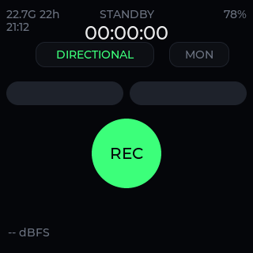
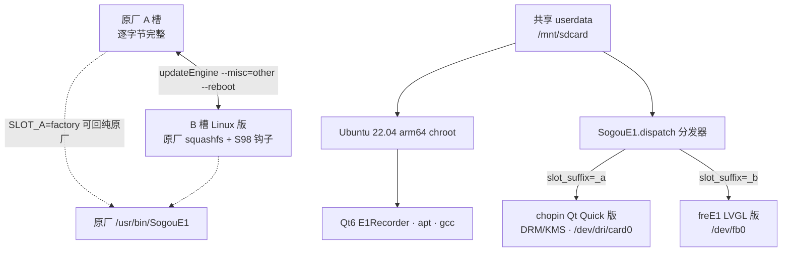
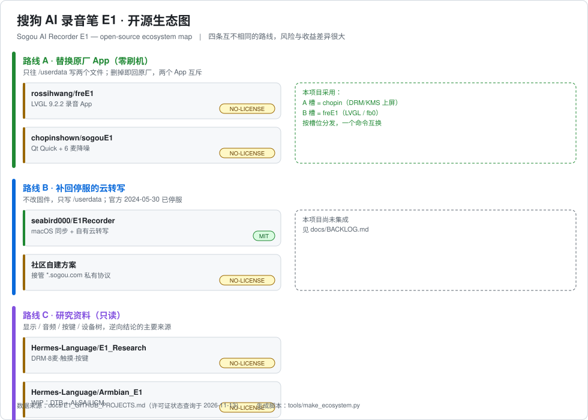

# Sogou E1 Open

[](https://github.com/dkworld123/Sogou-E1-Open/actions/workflows/ci.yml)
[](LICENSE)
[](docs/E1_SLOT_SWITCH.md)
[](docs/INSTALL.md)
[](README.en.md)

**简体中文** | [English](README.en.md)

> 搜狗 AI 录音笔 E1 的**非官方**开源自救工具集。官方云服务已于 **2024-05-30** 停服，
> 本项目让这支笔继续可用：导出录音、直录 8 麦阵列、跑完整 arm64 Linux、装开源录音 App。
> **原厂 A 槽全程逐字节完整，随时可回退**；不改 uboot / trust / GPT，仓库不含任何原厂固件镜像。



*从设备 `/dev/fb0` 抓帧转出的真实界面（320×320，LVGL 9.2.2）*

| | |
|---|---|
| 适用设备 | 搜狗 AI 录音笔 E1（RK3308 / Linux 4.4.143 / Buildroot 2018.02-rc3） |
| 验证范围 | **一台**设备真机实测，2026-11-13；其它批次请自行核对分区与 MD5 |
| 刷机要求 | 大部分玩法**零刷机**；仅 B 槽实验需要写 `system_b` |
| 维护状态 | 个人研究记录整理，无官方支持、无版本承诺 |
| 许可证 | [MIT](LICENSE)（仅覆盖本项目原创内容）；第三方见 [THIRD_PARTY.md](THIRD_PARTY.md) |

---

## 目录

- [0. 开始之前（必读）](#0-开始之前必读)
- [1. 能做什么](#1-能做什么)
- [2. 前置条件](#2-前置条件)
- [3. 安装](#3-安装)
- [4. 快速开始](#4-快速开始)
- [5. 目录结构](#5-目录结构)
- [6. 文档导航](#6-文档导航)
- [7. 真机核实过的设备事实](#7-真机核实过的设备事实)
- [8. 关键结论](#8-关键结论)
- [9. 回滚通道](#9-回滚通道)
- [10. 已知局限与未完成](#10-已知局限与未完成)
- [11. 开源生态速览](#11-开源生态速览)
- [12. 声明、许可证与致谢](#12-声明许可证与致谢)

---

## 0. 开始之前（必读）

> ⚠️ **先读 [`docs/NOTICE.md`](docs/NOTICE.md)**，那里集中列出了全部注明事项：
> 变砖与保修风险、录音合规、隐私脱敏、上游许可证、操作禁忌、未验证项。

三条底线：

1. **先备份**：动分区前，自行 `dd` 备份 `boot_a/b`、`system_a/b`、`misc`。本仓库不提供原厂镜像。
2. **原厂 A 槽不动**：这是最后一道保险；所有实验只写 `system_b` 与共享的 `userdata`。
3. **写操作要显式确认**：`slot_tool.sh` 默认只读预演，真正执行必须加 `--go`。

本项目**与搜狗官方无任何关联**，不含任何原厂固件、分区镜像、录音或数据库；
写分区、拆机可能变砖，**风险自负**。文档里的 MD5、PARTUUID、序列号均为占位/示例值，你的设备可能不同。

---

## 1. 能做什么

| 能力 | 做法 | 是否改分区 |
|---|---|---|
| 停服后导出全部录音 | `scripts/export_recordings.py` 读 `E1-DATA.db` + `adb pull` | ❌ 纯只读 |
| 直录 8 麦阵列 | 用原厂命名 PCM `8c48kmic`（8ch / 48 kHz / S32_LE） | ❌ 纯只读 |
| 跑完整 arm64 Linux | 原厂内核 + Ubuntu 22.04.5 **chroot**（不刷机） | ❌ 只写 `userdata` |
| 编译 C/C++/Qt 程序 | 设备本机 chroot 内原生 gcc / cmake / apt | ❌ |
| 可回退的 A/B 双系统 | 只重打包 `system_b` squashfs，加一个开机钩子 | ⚠️ 仅 `system_b` |
| 两套录音 App 分槽启动 | 共享 `userdata` 上的**按槽位分发 launcher** | ❌ 纯 `userdata` |

最后两项已真机跑通：**A 槽 = chopin Qt Quick 版（DRM/KMS 上屏）**，
**B 槽 = freE1 LVGL 版（fb0 上屏）**，`updateEngine --misc=other --reboot` 一键互换，
每次约 20 秒上线，四个分区 MD5 全程未变。

---

## 2. 前置条件

- **一支自己的 E1**，且能在「通用设置 → 关于本机 → 连续点击『MAC 地址』→ 开发者模式 → 基本设置」里打开 **adb**。
- **PC 侧**：Android Platform-Tools（`adb` 在 PATH，或用 `ADB` 变量指向 `adb.exe`）、Python 3、`curl`、Git Bash / sh；Windows 一键脚本在 `windows/`。
- **USB 连接优先**：WiFi adb 会因设备省电掉线，容易让切槽命令「看起来发了其实没发」。
- **先确认设备在线**：`adb devices -l`，再 `export E1_SERIAL=<你的 adb 序列号>`（不设则脚本自动取第一台）。
- Git Bash 下执行设备路径命令时设置 `MSYS_NO_PATHCONV=1`，否则 `/mnt/sdcard/...` 会被改写成 Windows 路径。可直接 `. scripts/e1_env.sh` 一次配好。

完整清单见 [`docs/INSTALL.md`](docs/INSTALL.md) 第 1 节。

---

## 3. 安装

按风险从低到高分四级，**建议按顺序、逐级验证**，每级都可独立回退：

| 级别 | 内容 | 改动范围 | 详细步骤 |
|---|---|---|---|
| L0 | 导出录音 / 8 麦直录 | 无（只读） | [INSTALL §2](docs/INSTALL.md#2-l0-导出录音只读推荐先做) |
| L1 | Ubuntu 22.04 arm64 chroot | `/mnt/sdcard` | [INSTALL §3](docs/INSTALL.md#3-l1-设备本机-linux零刷机) |
| L2 | 两套录音 App + 分槽分发 | `/userdata` | [INSTALL §4](docs/INSTALL.md#4-l2-录音-app-与分槽分发纯-userdata) |
| L3 | 改造 `system_b`，开机自启 Linux | **仅 `system_b`** | [INSTALL §5](docs/INSTALL.md#5-l3-b-槽系统写分区请先备份) |

> **只想要回录音？做到 L0 就够了。** L1–L3 是研究性质，不是日常必需。

---

## 4. 快速开始

```sh
# 0) 环境（Git Bash / sh）
. scripts/e1_env.sh                 # 设置 ADB / E1_SERIAL / MSYS_NO_PATHCONV

# 1) 只读导出录音（零风险）
python3 scripts/export_recordings.py --list
python3 scripts/export_recordings.py --out ./my_recordings

# 2) 进设备本机 Linux
sh tools/fetch_deps.sh              # 取 Ubuntu base / Alpine minirootfs 等依赖
# Windows 可双击 windows/install_e1_linux.bat
adb -s "$E1_SERIAL" shell "sh /mnt/sdcard/enter_linux.sh ubuntu 'cat /etc/os-release'"

# 3) 看槽位（只读），确认后再切
adb -s "$E1_SERIAL" shell "sh /mnt/sdcard/slot_tool.sh status"
adb -s "$E1_SERIAL" shell "/usr/bin/updateEngine --misc=other --reboot"

# 4) 管理两套录音 App
sh stage3/e1_app_switch.sh status
sh stage3/e1_app_switch.sh slots                  # A=chopin  B=freE1（默认）
```

更多命令见 [`docs/USAGE.md`](docs/USAGE.md)；卡住了看 [`docs/FAQ.md`](docs/FAQ.md)。

> `docs/` 下的技术报告写于开发期，旧路径按下表对应到整理后的目录：
>
> | 报告里的旧路径 | 本仓库 |
> |---|---|
> | `e1_armbian/*.sh` | `scripts/` |
> | `e1_armbian/stage2/*` | `stage2/` |
> | `e1_armbian/stage3_freE1/*` | `stage3/` |
> | `e1_qt5_recorder/*` | `qt5-recorder/` |
> | `e1_exporter.py` | `scripts/export_recordings.py` |
> | `e1_stock_backup/`、`rootfs/`、`qt_src/`、`toolchain/` | **不在仓库**，见 `tools/fetch_deps.sh` |

---

## 5. 目录结构

```
.
├── README.md                 本文件（入口）
├── README.en.md              English version of the same document
├── LICENSE                   MIT（仅覆盖本项目原创内容）
├── CHANGELOG.md              版本记录
├── CONTRIBUTING.md           贡献约定
├── THIRD_PARTY.md            上游项目 / 许可证状态 / 不打包说明
├── .gitignore                排除固件 / 录音 / 依赖 / 个人数据
├── .gitattributes            换行符约定：设备端脚本强制 LF
├── .github/
│   ├── workflows/ci.yml      CI：语法检查 + 链接检查 + 敏感串扫描
│   └── ISSUE_TEMPLATE/       Bug / 功能建议表单
├── docs/
│   ├── NOTICE.md             ★ 注明事项：风险、免责、合规、隐私、禁忌、未验证项
│   ├── INSTALL.md            ★ 前置条件 + 分级安装 + 验证 + 回滚
│   ├── USAGE.md              ★ 日常命令速查
│   ├── FAQ.md                ★ 常见问题与排错
│   ├── BACKLOG.md            未完成事项与优先级
│   ├── E1_SLOT_SWITCH.md     A/B 槽机制、阶段 1/2 实测、分槽（最核心）
│   ├── E1_APPS_INSTALLED.md  两套 App 的编译、5 个坑、验证证据
│   ├── E1_LINUX_INSTALLED.md chroot Ubuntu 安装与使用
│   ├── E1_ARMBIAN_INSTALL.md 为什么没做「真 Armbian」
│   ├── E1_ARMBIAN_PLAN.md    早期刷机计划（保留作反面参考）
│   ├── E1_GITHUB_PROJECTS.md GitHub 生态调研清单
│   ├── SESSION_NOTES.md      开发期会话手记
│   ├── UPSTREAM_PATCHES.md   对上游源码的改动（diff 文本，不分发上游文件）
│   └── images/               真机界面截图 + 生态图
├── scripts/                  PC / 设备两侧通用脚本（导出、chroot、切槽、恢复）
├── stage2/                   B 槽镜像构建（squashfs 注入 S98 钩子）
├── stage3/                   应用层分发器与全静态编译配置
├── qt5-recorder/             自写 Qt 5.9.4 录音器工程（C++ / QML / ALSA）
├── configs/                  原厂与改造版 asound.conf
├── windows/                  Windows 一键 bat / WSL2 辅助 ps1
└── tools/                    依赖获取、CI 检查脚本、生态图生成器（不含任何二进制）
```

---

## 6. 文档导航

| 想做的事 | 看这里 |
|---|---|
| 第一次上手 / 装之前要准备什么 | [`INSTALL.md`](docs/INSTALL.md) |
| 日常命令、切槽、换 App、看日志 | [`USAGE.md`](docs/USAGE.md) |
| 报错、连不上、屏幕没亮、是不是 Armbian | [`FAQ.md`](docs/FAQ.md) |
| **风险、免责、合规、隐私、操作禁忌** | [`NOTICE.md`](docs/NOTICE.md) |
| 还有哪些没做 / 想接坑 | [`BACKLOG.md`](docs/BACKLOG.md) |
| 想知道 A/B 槽是怎么推导出来的 | [`E1_SLOT_SWITCH.md`](docs/E1_SLOT_SWITCH.md) |
| 第三方项目清单与许可证 | [`THIRD_PARTY.md`](THIRD_PARTY.md) |
| 上游源码要改哪些地方 | [`UPSTREAM_PATCHES.md`](docs/UPSTREAM_PATCHES.md) |
| 提交 PR / 补文档 | [`CONTRIBUTING.md`](CONTRIBUTING.md) |

---

## 7. 真机核实过的设备事实

| 项目 | 值 |
|---|---|
| SoC / 内存 | Rockchip RK3308，4× Cortex-A35，约 502 MB 可用 RAM |
| 内核 | Linux **4.4.143**（Rockchip BSP，2020-01-13，Linaro GCC 6.3） |
| 原厂用户空间 | Buildroot 2018.02-rc3 / **glibc 2.26** / Qt **5.9.4** |
| Qt 路径 | 插件 `/usr/lib/qt/plugins/`，QML `/usr/qml`，`/usr/bin/qmlscene` |
| 显示 | 320×320，**DRM/KMS + VOP**；`/dev/fb0` 是「假帧缓冲」，Qt 靠 patched `libqlinuxfb.so` + `QT_QPA_FB_DRM=1` |
| 输入 | 触摸 `/dev/input/event0`，按键 `event1` / `event3` |
| 音频 | PDM 8 麦，card 2 `rockchip,pdm-mic-array`；命名 PCM `8c48kmic`；ch6/ch7 为主麦对 |
| 分区 | `boot_a/b` 各 20 MB，`system_a/b` 各 **400 MB squashfs**（gzip / 128 KB block），`misc` 1 MB |
| 原厂 system 实际占用 | **101.1 MB**（所以 1.45 GB 的 Ubuntu rootfs 塞不进 400 MB 分区） |
| 启动参数 | DTB `root=PARTUUID=614e0000-0000` 是**占位符**，uboot 按槽替换；`rootfstype=squashfs`，**无 `init=`** |
| A/B 状态 | `misc+0x800` 起 **3 份** AvbABData（magic `\0AB0`，CRC32）；`updateEngine --misc=other` 交换 priority |
| 开机报平安 | `/etc/init.d/S99_bootcontrol` → `updateEngine --misc=now` |
| App 启动链 | `inittab ::respawn:/usr/bin/SogouLunchProbe.sh` → `SogouLunch.sh` → 存在则 `exec /userdata/system/SogouE1` |

> 逐字节证据与回滚记录见 [`docs/E1_SLOT_SWITCH.md`](docs/E1_SLOT_SWITCH.md)。

### 架构



关键设计：**`userdata` 是 A/B 共享分区**，所以「两套 App 分槽」不是各装一份文件，
而是一个读 `/proc/cmdline` 判槽、再 `exec` 对应 launcher 的分发器
（[`stage3/SogouE1.dispatch`](stage3/SogouE1.dispatch)）。

---

## 8. 关键结论（都是踩出来的）

| # | 结论 |
|---|---|
| 1 | `/dev/fb0` 是假帧缓冲。LVGL 直接写 fb0 出画；Qt **走 DRM/KMS 不写 fb0**，所以「读 fb0 没变」不能证明没上屏 |
| 2 | `root=PARTUUID=614e0000-0000` 是占位符，uboot 按槽替换 → 换系统**不必改 `boot_b`** |
| 3 | misc 里有 **3 份** A/B 元数据，`updateEngine` 只更新影子份 → 别手改 misc 字节，一律用官方工具 |
| 4 | 原厂 glibc 2.26，新工具链编出的动态程序会 `symbol not found` → 用**全静态链接**绕过 |
| 5 | 静态链接 `-lm` 必须放在 `-lasound` **之后**，否则 `exp/pow/sqrtf` undefined |
| 6 | 静态 alsa-lib 把配置路径写死成构建目录 → 运行时必须 `export ALSA_CONFIG_PATH=/usr/share/alsa/alsa.conf` |
| 7 | Qt 首次启动 `Failed to create dumb buffer` 是 CMA 连续内存不足 → 启动前 `echo 3 > /proc/sys/vm/drop_caches` |
| 8 | 切槽前先确认 adb 在线；设备 WiFi 省电会掉线，重启后以 `cmdline` 的 `slot_suffix` 为准复核 |
| 9 | 400 MB 分区装不下 1.45 GB rootfs，独立原生根还会丢掉 adbd 回连通道 → 所以选「原厂底座 + chroot」 |

---

## 9. 回滚通道（从轻到重）

1. **删一个文件**：`rm -f /userdata/system/SogouE1` → A/B 两槽都回原厂 App。
2. **切槽**：`updateEngine --misc=other --reboot`；失败会自动回滚到上一槽。
3. **恢复 misc / system_b**：`slot_tool.sh restore --go`，或用备份 `dd` 回写 `system_b`。
4. **救砖**：`adb reboot loader` + `rkdeveloptool`，最后才是拆机短接 eMMC CLK↔GND 进 MaskROM。

> 原厂 A 槽在整个项目里**从未被写入**，这是最后一道保险。
> 第 4 条救砖通道**未实跑验证**，只做了机制推导，见 [`NOTICE.md`](docs/NOTICE.md)。

---

## 10. 已知局限与未完成

- 这不是「真 Armbian」：PID 1 仍是原厂 busybox init，没有 systemd、Armbian 内核包或 U-Boot 包。见 [`FAQ.md`](docs/FAQ.md) 与 [`docs/E1_ARMBIAN_INSTALL.md`](docs/E1_ARMBIAN_INSTALL.md)。
- 自研 Qt6 `E1Recorder` 默认 `offscreen`，未做原生上屏适配；物理屏幕观感需人工确认。
- 校时、云转写、SSH、`loader` / Rockusb / MaskROM 救砖均未落地。
- 上游 App 没有 Release，需自行编译；多个上游仓库**未声明 LICENSE**，本仓库只引用不打包。

完整待办见 [`docs/BACKLOG.md`](docs/BACKLOG.md)。

---

## 11. 开源生态速览

整个 E1 生态到 2026-11 已形成四条**互不相同**的路线，风险和收益差别很大：
换 App 最实用且零风险，换系统风险最高。



*生态图由 `tools/make_ecosystem.py` 生成，数据来源 [`docs/E1_GITHUB_PROJECTS.md`](docs/E1_GITHUB_PROJECTS.md)。*

| 路线 | 代表项目 | 要不要刷机 | 适合谁 |
|---|---|---|---|
| **A. 替换原厂 App** | `freE1`、`chopin/sogouE1` | **不用**，只往 `/userdata` 写两个文件 | 想让屏幕、按键、8 麦重新有用的人 |
| **B. 补回云转写** | `E1Recorder`、社区自建方案 | 不用 | 想继续用转写/纪要的人 |
| **C. 研究资料** | `E1_Research`、`Armbian_E1` | 只读 | 想理解显示/音频/按键原理的人 |
| **D. 换系统 / 真 Armbian** | `build_e1`、`u-boot`、RK3308 SDK 系 | 要 | 愿意折腾且有救砖准备的人 |

> 多个上游仓库**未声明 LICENSE**（图中橙色角标），本仓库只引用、不打包其源码，
> 详见 [`THIRD_PARTY.md`](THIRD_PARTY.md)。

---

## 12. 声明、许可证与致谢

- **非官方**：与搜狗 / 官方无任何关联，仅作兼容性描述；商标归权利人所有。
- **不分发**：不含原厂固件、分区镜像、录音文件或数据库；请从自己的设备备份，且不要公开分发原厂固件。
- **第三方**：上游 `freE1`、`chopin sogouE1`、`Armbian_E1` 等未声明 LICENSE，请自行判断使用范围，详见 [`THIRD_PARTY.md`](THIRD_PARTY.md)。
- **风险自负**：写分区、刷机、拆机有变砖风险；完整注明事项见 [`docs/NOTICE.md`](docs/NOTICE.md)。
- 本项目原创脚本与文档采用 [MIT License](LICENSE)（`Copyright (c) 2026 Sogou E1 Open Source Contributors`）。

致谢：[`rossihwang/freE1`](https://github.com/rossihwang/freE1)、
[`chopinshown/sogouE1`](https://github.com/chopinshown/sogouE1)、
[`Hermes-Language/E1_Research`](https://github.com/Hermes-Language/E1_Research)、
[`Hermes-Language/Armbian_E1`](https://github.com/Hermes-Language/Armbian_E1)、
[`seabird000/E1Recorder`](https://github.com/seabird000/E1Recorder)、
[LVGL](https://github.com/lvgl/lvgl)、[alsa-lib](https://www.alsa-project.org/)，
以及 whycan.cn 上 E1 拆解讨论的各位。
